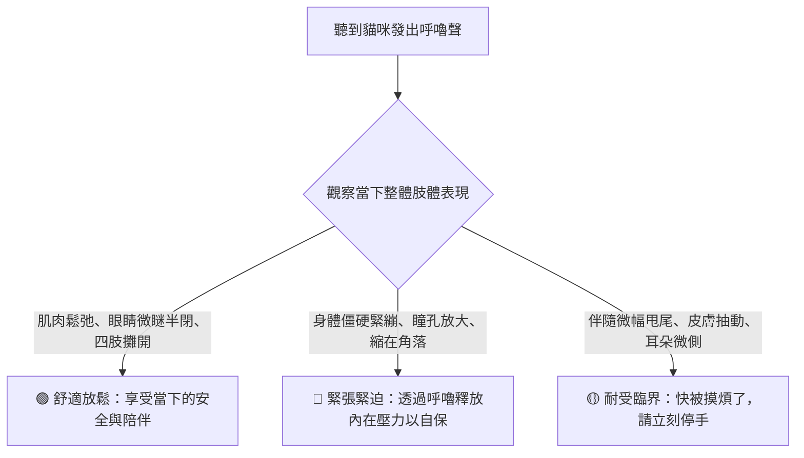

# 😺 呼嚕聲的雙重含意：放鬆滿足 vs 痛苦自我安撫

> [!NOTE] 官方指引行為澄清
> 農業部《寵物飼養與照顧指南－貓篇》第 5 頁明確指出：
> **「貓咪發出呼嚕聲，通常表示感到很舒適、安心；但在感受到緊張、焦慮、有壓力時，也會發出呼嚕聲以穩定自己的情緒。」**

---

## 📌 重點摘要 (Key Takeaways)
1. **呼嚕的本質是震動安撫**：呼嚕不僅是心情好的副產物，也是貓咪演化出來的「自我療癒與心理減壓機制」。
2. **不能單看聲音**：判斷呼嚕的意義，必須同時搭配**身體肌肉鬆緊度、眼睛狀態與耳朵方向**進行整體評估。
3. **低頻止痛效應**：呼嚕聲的聲波頻率（約 20~140 Hz）具有促進骨骼生長、組織修復及緩解生理痛苦的功能。

---

## ⚖️ 呼嚕情境對照判斷法

| 判讀維度 | 🟢 放鬆享受型呼嚕 | 🔴 緊張／病痛型呼嚕 |
| :--- | :--- | :--- |
| **身體姿態** | 四肢放鬆伸展、腹部或下巴自然露出、身體柔軟 | 身體捲曲成團或母雞蹲、肌肉僵硬緊縮 |
| **面部表情** | 眼睛半瞇甚至微合、面部表情柔和、鬍鬚自然下垂 | 瞳孔可能略大、眼神呆滯或戒備四處張望、耳朵略扁 |
| **互動表現** | 主動用頭臉磨蹭你的手、輕推撒嬌、緩慢踩踩 | 不主動接觸、被碰觸時身體微縮或凍結 |
| **訪客處置** | 溫和保持目前的撫摸頻率與節奏 | **立刻停止碰觸**，給予安靜不受打擾的空間 |

---

## 🔗 相關關聯頁面
- [[wiki/body-language/warning-signals|貓咪警戒與緊迫訊號解讀]]
- [[wiki/interactions/consent-first-approach|初次接觸與同意權法則]]
- [[wiki/scenarios/senior-cats-in-cafe|高齡店貓照護與身體病痛識別]]
