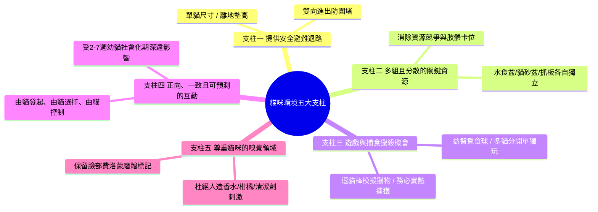

# 🏛️ 國際貓科醫學會：健康貓咪環境五大支柱 (The Five Pillars)

> [!NOTE] 權威醫學背書
> 本準則由國際貓科獸醫協會 (**FelineVMA / 原 AAFP**) 與國際貓家園 (**iCatCare**) 共同訂定。臨床獸醫研究指出，貓咪絕大多數的異常行為（攻擊咬人、亂尿噴尿、亂抓家具），皆源自於**環境需求未被滿足**或**社交關係緊迫**。這「五大支柱」是檢驗任何貓咖環境與訪客互動是否合格的最高黃金標準。

---

## 📌 五大支柱總覽 (Overview)

---

## 🔍 五大支柱深度剖析（貓咖實務落地）

### 支柱一：提供安全避難處所 (Safe Place)
* **規格要求**：
  * **單貓專屬空間**：大小僅容納一隻貓，具備包覆感（如紙箱、貓窩、外出籠底座）。
  * **離地墊高**：高於人眼水平的貓跳台或壁掛貓床，能大幅減少貓咪面對人類的威脅感。
  * **雙向進出通道 (Two-way exits)**：避難空間**絕不可只有單一死胡同出口**，至少要有兩個通道，避免被其他強勢貓或人類堵在死角。
* **貓咖準則**：訪客見到貓進入避難設施時，該空間視為「絕對隱私領域」，禁止窺探伸手。

### 支柱二：多組且分散的重要資源 (Multiple & Separated Key Resources)
* 關鍵資源包括：**水、食物、貓砂盆、抓板、睡窩、玩耍區**。
* **物理分散原則**：不可將所有貓砂盆或食盆集中排成一列。集中放置會讓「店霸貓」輕易佔據咽喉點，導致弱勢貓因不敢靠近而引發自發性膀胱炎 (FIC) 或憋尿問題。

### 支柱三：滿足捕食與遊戲天性 (Predatory Play)
* 獵食是貓咪維持心理健康的核心本能。
* **實體捕獲**：嚴禁使用雷射筆，因為無法捕獲實體會引發嚴重挫折焦慮。
* **個別玩耍 (Play Individually)**：在多貓咖啡廳內，若一根逗貓棒同時引來多隻貓，應分開區域單獨引導，避免激發爭搶衝突。

### 支柱四：正向、一致且可預測的人貓互動 (Human-Cat Interaction)
* 核心鐵律：**「由貓發起、由貓選擇、由貓控制接觸方式」 (Initiate, Choose, Control)**。
* 貓對人類的接納程度受幼年期（2~7 週齡）社會化影響極深。顧客若違背貓的意願強抱或硬摸，將直接摧毀人貓信任。

### 支柱五：尊重貓咪的嗅覺感知 (Sense of Smell)
* 貓咪透過磨蹭臉頰分泌「面部費洛蒙 (Facial Pheromones)」標示安全邊界。
* **禁止過度洗刷抹除**：切勿隨意用刺激性消毒水抹拭貓咪經常磨蹭的桌角椅腳。
* 店內可擴香使用「貓費洛蒙合成劑 (如 Feliway®)」，協助貓咪緩解陌生人進出的壓力。

---

## 🔗 相關關聯頁面
- [[wiki/etiquette/cafe-environment-welfare|貓咖空間環境與動物福利規範]]
- [[wiki/interactions/consent-first-approach|初次接觸與同意權法則]]
- [[wiki/interactions/play-rules|逗貓玩耍指南：實體捕獵成就感]]
- [[wiki/scenarios/cat-stress-olfactory|氣味危機與嗅覺焦慮應對]]
- [[wiki/scenarios/multi-cat-conflicts|多貓衝突與領地應對]]
